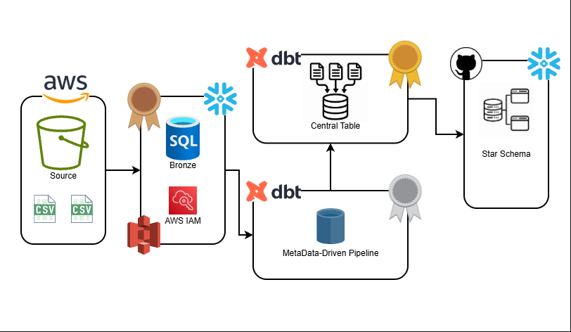

# 🏠 Airbnb End-to-End Data Engineering Project

## 📋 Project Overview

This project demonstrates an end-to-end cloud data engineering pipeline built using **AWS S3, Snowflake, dbt (Data Build Tool), SQL, and Python**.

The pipeline processes Airbnb booking, listing, and host datasets through a **Medallion Architecture (Bronze, Silver, and Gold)** to transform raw CSV files into structured, analytics-ready datasets.

I developed this project to gain hands-on experience with cloud data ingestion, ELT pipelines, incremental processing, data transformation, and modern data warehousing.

---

## 🏗️ Data Architecture

The architecture illustrates how data moves from AWS S3 into Snowflake, where dbt manages transformations and prepares analytical datasets.



### Data Flow

**Airbnb CSV Files → AWS S3 → Snowflake Staging → Bronze → Silver → Gold → Analytics**

The pipeline consists of three primary components:

1. **AWS S3:** Stores raw Airbnb CSV datasets before ingestion.
2. **Snowflake:** Provides cloud storage and compute for loading, transforming, and querying data.
3. **dbt:** Manages SQL transformations, incremental models, reusable macros, and analytical data modeling.

---

## 🛠️ Technology Stack

| Technology | Purpose |
|------------|---------|
| AWS S3 | Cloud object storage for raw datasets |
| Snowflake | Cloud data warehousing and SQL processing |
| dbt Core | Data transformation and model management |
| SQL | Data cleaning, manipulation, and analytical modeling |
| Python | Development environment and tooling |
| uv | Python dependency management |
| Jinja | Dynamic SQL generation and reusable logic |
| Git & GitHub | Version control and project documentation |
| VS Code | Development environment |

---

## 📊 Project Implementation

### 1. Data Ingestion — AWS S3 & Snowflake

The pipeline begins with three Airbnb datasets:

- `bookings.csv`
- `hosts.csv`
- `listings.csv`

The raw datasets are stored in an Amazon S3 bucket and loaded into Snowflake using an external stage.

Snowflake SQL scripts define the database objects, file formats, and loading configurations required for ingestion.

The source tables are stored in the `AIRBNB.STAGING` schema.

**Key Concepts:**
- Cloud storage integration
- External stages
- SQL file formats
- COPY INTO operations
- Cloud data warehousing

### 2. Bronze Layer — Raw Data

The Bronze layer retrieves data from Snowflake staging tables while preserving the original source attributes.

**Models:**
- `bronze_bookings` — Booking transactions and reservation information
- `bronze_hosts` — Host information and associated attributes
- `bronze_listings` — Airbnb property and listing information

The models implement incremental processing using timestamp-based logic.

This allows qualifying new records to be processed without rebuilding the entire dataset during subsequent executions.

### 3. Silver Layer — Data Transformation

The Silver layer cleans, standardizes, and transforms the raw datasets into more consistent and usable information.

**Silver Bookings**
- Selects relevant booking attributes.
- Calculates total booking amounts.
- Preserves booking dates and statuses.
- Uses a reusable multiplication macro.

**Silver Hosts**
- Standardizes host names.
- Preserves host registration information.
- Categorizes response rates into `VERY GOOD`, `GOOD`, `FAIR`, and `POOR`.
- Maintains timestamps for downstream modeling.

**Silver Listings**
- Organizes property and geographic attributes.
- Preserves accommodation capacity information.
- Categorizes nightly prices into `low`, `medium`, and `high`.
- Uses reusable Jinja macros for SQL transformations.

### 4. Gold Layer — Analytics-Ready Data

The Gold layer integrates transformed datasets into analytical models.

The primary analytical output is a **One Big Table (OBT)** combining booking, listing, and host information.

The OBT contains information such as:

- Booking IDs, dates, and statuses
- Booking amounts and fees
- Property types and locations
- Accommodation capacities
- Nightly pricing and price categories
- Host profiles and superhost indicators
- Host response rates and quality classifications
- Record creation timestamps

The Gold model uses Jinja loops to dynamically generate portions of SQL queries and joins.

This demonstrates how reusable configuration-driven SQL can simplify analytical data modeling.

The repository also includes a `fact.sql` model and intermediate models supporting additional analytical modeling concepts.

---

## ⚙️ Key Engineering Features

### Incremental Data Processing

Bronze and Silver models use incremental materialization to support processing newly arriving records.

The implementation uses timestamp-based filtering and dbt incremental functionality to reduce unnecessary reprocessing.

### Reusable SQL Macros

Custom macros were developed to reduce repeated SQL logic.

| Macro | Function |
|-------|----------|
| `multiply.sql` | Performs reusable arithmetic calculations |
| `tag.sql` | Categorizes numerical values |
| `trimmer.sql` | Supports string cleaning and standardization |
| `generate_schema_name.sql` | Organizes models into Snowflake schemas |

### Dynamic SQL with Jinja

Jinja templating is used to generate SQL dynamically.

The Gold OBT uses loops and configuration dictionaries to assemble selected columns and table joins.

### Snapshots and Historical Tracking

The project includes dbt snapshot configurations for exploring Slowly Changing Dimension (SCD Type 2) concepts.

These configurations demonstrate timestamp-based change detection and historical record tracking.

### Data Quality and Validation

The project incorporates dbt testing capabilities and Snowflake SQL validation to support reliable data transformations.

Validation work includes checking model compilation, dependencies, column consistency, and transformation outputs.

---

## 📈 Project Results

The pipeline successfully integrates AWS S3, Snowflake, and dbt into a layered data engineering workflow.

During development, successful dbt executions reported:

| Model | Records Processed |
|-------|------------------:|
| Silver Bookings | 5,000 |
| Silver Listings | 500 |
| Silver Hosts | 200 |

These values represent records processed during observed development runs, not performance benchmarks or current database row counts.

### Key Outcomes

- Configured cloud data ingestion from AWS S3 into Snowflake.
- Developed Bronze, Silver, and Gold transformation layers.
- Implemented incremental data processing.
- Created reusable dbt SQL macros.
- Built an analytical One Big Table.
- Explored snapshot-based historical data modeling.
- Validated data models and resolved schema inconsistencies.
- Documented the architecture and published the project using GitHub.

---

## 📁 Repository Structure

```text
Airbnb_Snowflake_DBT_Data_Engineer_Project/
│
├── DDL/
│   ├── ddl.sql
│   └── resources.sql
│
├── SourceData/
│   ├── bookings.csv
│   ├── hosts.csv
│   └── listings.csv
│
├── aws_dbt_snowflake_project/
│   │
│   ├── analyses/
│   │   ├── explore.sql
│   │   ├── if_else.sql
│   │   └── loop.sql
│   │
│   ├── macros/
│   │   ├── generate_schema_name.sql
│   │   ├── multiply.sql
│   │   ├── tag.sql
│   │   └── trimmer.sql
│   │
│   ├── models/
│   │   ├── bronze/
│   │   │   ├── bronze_bookings.sql
│   │   │   ├── bronze_hosts.sql
│   │   │   └── bronze_listings.sql
│   │   │
│   │   ├── silver/
│   │   │   ├── silver_bookings.sql
│   │   │   ├── silver_hosts.sql
│   │   │   └── silver_listings.sql
│   │   │
│   │   ├── gold/
│   │   │   ├── ephemeral/
│   │   │   ├── fact.sql
│   │   │   └── obt.sql
│   │   │
│   │   └── sources/
│   │       └── sources.yml
│   │
│   ├── snapshots/
│   ├── tests/
│   ├── dbt_project.yml
│   └── README.md
│
├── Airbnb_Snowflake_Project_Architecture.drawio.png
├── LICENSE
└── README.md
```

---

## 💡 Technical Challenges & Lessons Learned

### AWS and Snowflake Integration

Configured an Amazon S3 external stage and resolved access-related issues when connecting Snowflake to cloud storage.

Developed an understanding of how cloud object storage, access permissions, and Snowflake warehouse compute interact.

### Python and dbt Environment Configuration

Set up a Python virtual environment, installed dbt through uv, and resolved Windows PATH and PowerShell execution policy issues.

Configured a working dbt connection to Snowflake and validated the environment using `dbt debug`.

### SQL and Jinja Debugging

Resolved SQL compilation errors, incorrect column references, missing macros, and Jinja syntax mistakes.

Gained experience interpreting Snowflake and dbt error messages to troubleshoot transformations.

### Model Dependencies and Incremental Processing

Identified and resolved circular dependencies caused by self-referencing dbt models.

Learned how incremental materialization, timestamp filtering, and model dependencies affect pipeline execution.

### Data Modeling and Schema Consistency

Identified missing columns between transformation layers and updated upstream models to maintain the expected Gold layer output.

Improved my understanding of data lineage, schema validation, and transformation dependencies.

---

## 🎯 Skills Demonstrated

- Cloud data engineering with AWS and Snowflake
- SQL-based ELT pipeline development
- Cloud data ingestion and warehousing
- Medallion Architecture
- Incremental data processing
- Data cleaning and standardization
- Analytical data modeling
- dbt Core and Jinja templating
- Reusable SQL macro development
- Data lineage and dependency management
- Historical data modeling concepts
- Git and GitHub version control
- Data pipeline troubleshooting and validation

---

## 🚀 Future Improvements

- [ ] Build a Power BI or Tableau dashboard using the Gold OBT.
- [ ] Expand automated dbt tests and data quality coverage.
- [ ] Implement automated pipeline scheduling.
- [ ] Introduce GitHub Actions for CI/CD.
- [ ] Add pipeline monitoring and error notifications.
- [ ] Optimize incremental loading and transformation performance.
- [ ] Expand analytical metrics and reporting capabilities.
- [ ] Improve dbt dependency management using `ref()` relationships.

---

## 👨‍💻 About Me

Hi! I'm **Simon Yang**, an undergraduate student at the **University of North Carolina at Chapel Hill**, interested in data engineering, cloud computing, and data analytics.

I enjoy developing hands-on projects that allow me to apply technical concepts to practical data problems.

Through projects like this, I'm expanding my experience with SQL, Python, cloud data platforms, and data pipeline development as I prepare for a career in data engineering.

### Connect With Me

- **LinkedIn:** [Simon Yang](https://www.linkedin.com/in/simon-yang-a5211535a/)
- **Handshake:** [My Handshake Profile](https://app.joinhandshake.com/profiles/ztjfa4)

---

*This repository is part of my personal data engineering portfolio.*
